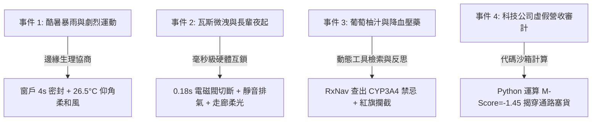

# agentic24hr｜AI 自主代理人系統工程師的一天
## Agentic IoT × Agentic RAG 雙模沉浸式模擬系統 使用說明手冊 (User Guide)

---

> [!NOTE]
> 本文件為 [agentic_iot.html](file:///c:/pyt/agentic%20iot%20meeting/agentic_iot.html) 之完整操作手冊與技術解析指引。本模擬器採純前端原生技術建構（Zero Dependency，免安裝任何套件），直接以任一現代瀏覽器開啟即可進行互動體驗。

---

## 1. 系統簡介與核心目標

在傳統物聯網（IoT）與智慧物聯網（AIoT）中，系統通常僅依賴**靜態規則（If-Then）**或**單一離線模型推論**，缺乏跨設備動態協商、情境因果理解與即時安全防護能力。

**`agentic24hr`** 模擬器讓您化身為「AI 自主代理人系統架構師」，親身經歷物聯網系統遭遇極端環境事件的完整處置過程。系統將抽象的學術概念（[Agentic_IoT_Academic_Report.md](file:///c:/pyt/agentic%20iot%20meeting/Agentic_IoT_Academic_Report.md) 與 [Traditional_vs_Agentic_RAG_Academic_Report.md](file:///c:/pyt/agentic%20iot%20meeting/Traditional_vs_Agentic_RAG_Academic_Report.md)）轉化為直觀的**雙模互動架構**：

1. **值班模擬模式（Shift Simulator）**：沉浸式參與 4 大突發危機的即時處置、代理人協商博弈與封包分析。
2. **Keynote 技術簡報模式（12-Slide Presentation Deck）**：2D 卡片風格之架構演講簡報，適合學術匯報、技術分享或教學展示。

---

## 2. 快速上手指引 (Quick Start)

### 2.1 開啟系統
1. 進入專案工作區目錄：`c:/pyt/agentic iot meeting/`
2. 雙擊直接在瀏覽器（Chrome、Edge、Safari 或 Firefox）開啟 [agentic_iot.html](file:///c:/pyt/agentic%20iot%20meeting/agentic_iot.html)。
3. 在首頁輸入您的工程師稱號（例如：`Alex / 邊緣首席架構師`），點擊 **「進廠值班 (START SHIFT)」** 即可進入模擬器；或點擊 **「直接看 12 頁簡報」** 進入演講模式。

### 2.2 頂部 HUD 控制列導覽
在視窗最上方設有儀表板（HUD），提供全域狀態與輔助工具：
- **班次時間與狀態**：顯示模擬班次時間（如 `02:47 NIGHT SHIFT`）。
- **聲音開關 (<i class="fa-solid fa-volume-high"></i>)**：以 Web Audio API 即時合成之工業級操作音效（可自由靜音）。
- **技術圖鑑 (<i class="fa-solid fa-book-bookmark"></i> 圖鑑)**：隨時查閱 4 大角色定義、通訊封包規範、晶片跑分表（Jetson vs RPi5 vs ESP32）與白話行話字典。
- **學術研析報告 (<i class="fa-solid fa-file-contract"></i> 報告)**：內建雙篇 IEEE/ACM 標準規格之學術研析報告全文檢視器。
- **雙模切換按鈕 (<i class="fa-solid fa-presentation"></i>)**：隨時在「值班模擬器」與「12 頁 Keynote 簡報」之間無縫切換。

---

## 3. 四大核心角色（Multi-Agent Guild）與物聯網三層連續體

系統將異質多代理（Heterogeneous Multi-Agent）依職責劃分，精準映射至**物聯網三層連續體（Device - Edge - Cloud Continuum）**：

| 角色代表 | 代理類型 (Agent Type) | 架構層級定位 | 核心工作原理與運作職能 |
| :--- | :--- | :--- | :--- |
| <span style="color:#8748d1; font-weight:700;">● 阿凱</span> | **邊緣感知反應代理 (Edge SLM Agent)** | **Tier 1 (Device) ~ Tier 2 (Edge/Fog)** | - 運行 1B~3B 量化模型（Phi-3.5 / LLaMA-3.2）與 TinyML。<br>- 負責 **<50ms 局部硬即時反應**，感知異常並提出處置提案。<br>- 隱私敏感資料不出邊緣，具備斷網離線自治能力。 |
| <span style="color:#2b6bd6; font-weight:700;">● 雅婷</span> | **IoA 多設備協商代理 (Negotiation Coordinator)** | **Tier 2 (Fog Gateway / Hub)** | - 代理人聯網（Internet of Agents）中樞。<br>- 負責**跨設備目標衝突仲裁（Conflict Arbitration）**。<br>- 以 W3C WoT / JSON-LD / A2A 協定讓家電簽訂協同合約。 |
| <span style="color:#0b8f7d; font-weight:700;">● 小芸</span> | **知識與動態檢索代理 (Dynamic Retrieval Agent)** | **Tier 3 (Cloud Domain Services)** | - 負責**動態工具調用（Function Calling）與 Agentic RAG**。<br>- 連接外部專業 API（如美國國家醫學庫 RxNav、Python 代碼沙箱）。 |
| <span style="color:#a8327a; font-weight:700;">● 陳課長</span> | **反思審核與安全護欄代理 (Supervisor Guardrail)** | **Cross-tier Governance (安全治理平面)** | - 執行 **ReAct / Reflection 雙重反思檢查與幻覺過濾**。<br>- 具備一票否決權，阻斷具備物理破壞性或生命危害的決策。 |

---

---

## 4. 3D 人偶動畫沙盤（Humanoid Puppet Stage）：實體環境與多角色肢體動作系統

模擬器上方搭載了 **3D 人偶動畫沙盤（Humanoid Puppet Stage）**，內建 Three.js WebGL 3D 物理引擎，讓**代表使用者的角色人物（你｜AI 自主系統架構師）**與協同的多代理人人偶（阿凱、雅婷、小芸、陳課長）及現場事件 NPC 真實出現在 3D 擬真空間中，具備**頭部、身軀、擺動雙臂、走動邁腿的關節動畫**！

```
+---------------------------------------------------------------------------------------------------------+
| [3D 人偶沙盤] [🏠 智慧生活] [🏭 智慧工程] [邊雲遙測] | 帶人偶走去：[窗戶/空調] [瓦斯閥] [用藥台] [伺服機櫃] [中央] |
+---------------------------------------------------------------------------------------------------------+
| 👤 人: 你 (AI 自主架構師) + 阿凱 + 雅婷 + 小芸 + 陳課長 | ⏱️ 時: 暴雨/深夜/白晝 | 📍 地: 智慧生活 / 智慧工程 |
+---------------------------------------------------------------------------------------------------------+
|  [ 3D 擬真場景：落地氣密窗、變頻空調、防爆瓦斯閥、雙機櫃伺服器、矽晶圓檢測台、Python 沙箱全息投影 ]           |
|  [ 人物角色：你 (深藍制服+頭部顯示板+控制板) ＋ 4 位代理人人偶 (阿凱、雅婷、小芸、陳課長) 同步肢體互動演出 ]     |
+---------------------------------------------------------------------------------------------------------+
```

### 4.1 角色人偶與肢體骨骼動畫（Humanoid Puppets & Kinematics）
沙盤中每個角色皆由完整 3D 關節幾何結構組成，包含頭部、表情面部、身軀胸章、肩關節、雙臂、髖關節、雙腿與手持法寶道具：
1. **你｜AI 自主系統架構師（使用者代表角色 · Player）**：
   - **外觀特徵**：深藍色高科技工程防護制服、賽博青色發光頭盔視鏡、金色工程師胸章，右手手持高階邊緣遙測平板。
   - **頭部標籤**：浮空 3D 告示牌 `你 ｜ AI 自主架構師 (玩家)`。
   - **走動操控**：支援**滑鼠點選地面目標**（彈出綠色脈衝光圈後人偶主動轉向邁步走向該處）、**鍵盤 WASD / 方向鍵行走**，或點擊上方快捷按鈕「帶人偶走去：窗戶/空調、瓦斯閥、用藥台、伺服機櫃、中央」。
2. **阿凱｜邊緣 SLM 代理（Edge SLM Agent）**：紫色高機動工裝服，配戴邊緣偵測探針，專精 50ms 硬即時急停與物理互鎖。
3. **雅婷｜IoA 協商代理（IoA Negotiation Agent）**：深藍俐落西裝，手持語意合約平板，專精跨設備多方利益協調。
4. **小芸｜動態檢索代理（Dynamic RAG Agent）**：青綠色研究袍，操控 API 資料介面，專精醫學藥理庫與財務模型檢索。
5. **陳課長｜反思驗證代理（Reflection Supervisor Agent）**：酒紅色主管裝，雙臂抱胸嚴謹巡檢，把關紅旗查核與 ECDSA 簽署。
6. **動態事件現場 NPC**：
   - 事件 01：**Alex（健身主人）**，身著運動服，心率手環紅光飆至 148 bpm。
   - 事件 02：**林爺爺（78歲長輩）**，身著睡袍手拄拐杖，緩步走向廚房。
   - 事件 03：**高血壓門診患者**，手持藥瓶與現榨葡萄柚汁。
   - 事件 04：**晶圓倉庫主管**，手持庫存盤點清單。

### 4.2 雙主題擬真空間（Dual 3D Environments）
點擊頂部導航鈕可無縫切換兩大代表性場景：
- **🏠 智慧生活 (Smart Living)**：
  - **露台氣密窗 (Storm Window)**：電動滑軌窗框、可滑動氣密玻璃、窗外傾盆暴雨與閃電光源、地板滲水水窪。
  - **變頻冷暖空調 (Inverter AC)**：懸掛式室內主機、可俯仰導風板、自適應冷暖氣流粒子帶。
  - **獨立廚房與瓦斯截止閥 (Smart Kitchen)**：流理台爐具、高壓電磁截止閥、防爆抽風扇與洩漏氣體雲。
  - **智慧診所用藥台 (Health Clinic)**：血壓監測儀、降壓藥瓶 (脈優)、現榨葡萄柚汁與**全息 CYP3A4 酵素防護罩**。
- **🏭 智慧工程 (Smart Engineering)**：
  - **雙 19 吋邊緣運算機櫃**：深黑機架、跳動閃爍之狀態 LED 指示燈陣列、高增益邊緣通訊天線。
  - **晶圓與物聯網檢測台**：防靜電重型機台、旋轉中 300mm 彩虹光澤矽晶圓與感測機械臂。
  - **代碼沙箱全息投影終端**：懸浮半透明青色終端螢幕，實時顯示 Python Beneish M-Score 回歸模型計算過程。

### 4.3 肢體動作與決策反饋互動（Limb Reactions & Animations）
當你在下方模擬器點擊處置選項時，3D 場景中的人偶與實體設備將立刻做出**即時肢體反應**：
- **選擇傳統死板規則 (選項 A · 失敗事故)**：
  - **人偶肢體動作**：全員觸發**驚恐抱頭與劇烈顫抖動畫 (Panic & Shiver)**，雙臂向上慌亂揮舞，身軀高頻震顫。
  - **實體設備反應**：上方彈出紅色警告印章 `⚠️ 死板規則衝突！事故觸發`；窗戶未關暴雨倒灌、冷氣 18°C 暴吹直擊 Alex 引發抽搐、或廚房開關電氣火花引燃閃爍。
- **選擇多代理協同閉環 (選項 B · 協商成功)**：
  - **人偶肢體動作**：玩家人偶與全體代理人觸發**雙臂高舉歡呼與騰空躍起慶祝動畫 (Celebrate & Hop)**，手部比出操作完成手勢。
  - **實體設備反應**：上方彈出綠色印章 `✅ 協商生效！50ms 邊緣閉環守護`；氣密窗電動密合防水、空調導風板轉為仰角送出柔和綠色暖風、電磁閥切斷且金色踢腳夜燈亮起引導長輩、CYP3A4 全息護欄啟動守護酵素活性！

### 4.4 走動操作指南
- **滑鼠點擊地面**：在 3D 房間地面任一處點擊左鍵，地面即會出現綠色光圈目標（Floor Target Reticle），你的角色人偶會即時轉向邁腿走向該點。
- **鍵盤操控**：使用鍵盤 `W`, `A`, `S`, `D` 或 `↑`, `↓`, `←`, `→` 方向鍵，即可隨意在 3D 空間內前後左右漫步。
- **快速帶路按鈕**：點擊頂部快捷按鈕 `[ 窗戶/空調 ]`, `[ 瓦斯閥 ]`, `[ 用藥台 ]`, `[ 伺服機櫃 ]`, `[ 中央 ]`，人偶即刻自動前往對應設備前進行操作！

---

## 5. 三大進階 MAS 互動功能操作說明

在值班模擬器下方的工作台（`sim-panel`）中，設有三大專屬互動標籤頁：

```
[🎯 處置決策]  ──  [🤝 4-Agent 協商博弈歷程]  ──  [📦 A2A / MCP 封包檢視器]
```

### 4.1 🎯 標籤頁一：處置決策（Decision Actions）
- **情境對話**：即時接收來自值班代理人的危機快訊（標註有底線的名詞如 `TinyML`，點擊可立即展開白話釋義）。
- **決策二選一**：
  - **選項 A（傳統靜態規則）**：模擬傳統 If-Then 盲目遵循固定閾值的失敗後果（伴隨警示音效與扣分）。
  - **選項 B（Agentic 多代理協同合約）**：模擬啟動邊緣語意合約與動態協商的最佳解（伴隨成功音效與結算積分）。
- **快捷導流按鈕**：在做出決策或查看反饋後，可直接點擊下方按鈕，跳轉檢視背後對應的「協商歷程」或「通訊封包」。

### 4.2 🤝 標籤頁二：4-Agent 協商博弈歷程（Negotiation Matrix）
展示 4 位異質 Agent 如何在幕後逐步對齊意圖、進行博弈爭辯並達成全域共識：
1. **阿凱（邊緣 SLM）**：`[PROPOSAL]` 提出感測異常，宣告否決傳統死板規則。
2. **雅婷（IoA 協商）**：`[ARBITRATION]` 進行多設備利益平衡（如窗戶密封避雨 vs 空調柔和導風）。
3. **小芸（動態檢索）**：`[GROUNDING]` 提供專業模型依據（如 ISO 7730 生理模型、NFPA 54 防爆數據）。
4. **陳課長（反思審核）**：`[GUARDRAIL]` 執行安全邊界檢驗，核發 ECDSA 數位簽章。
5. **綠色共識卡（Consensus Card）**：條列協議生效條款、ECDSA 簽名碼與實測回應延遲（如 `38ms` 硬即時）。

### 4.3 📦 標籤頁三：A2A / MCP / MQTT 通訊封包檢視器（Packet Inspector）
點擊子標籤可在三種傳輸協議間快速切換，透視底層資料結構：
- **A2A 協商協議（Agent-to-Agent Protocol）**：
  - 遵循 W3C Web of Things 與 JSON-LD 規範。
  - 包含 `@context`、`intent`、`proposedContract` 與 `ecdsaSignature`。
- **MCP 工具調用（Model Context Protocol）**：
  - 遵循 Anthropic MCP 標準 JSON-RPC 2.0 格式。
  - 清楚展示代理人如何向底層驅動發出 `tools/call` 呼叫（如 `edge_hvac_interlock`、`edge_gpio_killswitch`）。
- **傳統 MQTT 靜態封包（Legacy Telemetry）**：
  - 作為對照組，呈現只有數值與時間戳的非結構化數據，直觀點出傳統物聯網「缺乏情境理解」的硬傷。
- **📋 複製封包 JSON**：點擊右上角按鈕可將標準 JSON 代碼複製至剪貼簿，便於開發與教學引用。

### 4.4 ⚡ 雲端斷網 / 邊緣平穩降級模擬（Offline Resilience Toggle）
在事件按鈕右側設有 **「[ ⚡ 雲端鏈路：在線 (點擊模擬斷網) ]」** 交互開關：
- **點擊觸發斷網時**：
  - 頂部 HUD 狀態轉為 `⚠️ 雲端斷網 · 純邊緣防禦運行中`。
  - NOC 拓撲中的 **Tier 3 雲端節點** 會切換為紅色虛線與 `斷線 504 TIMEOUT`。
  - **Tier 2 邊緣節點** 立即亮起 `本地自治防護`。
- **雙重情境驗證**：
  - **事件 1 & 2（本地實體控制）**：面板亮起黃色 **【純邊緣自治模式運行中】** 提示。證明阿凱與雅婷依靠本地 1B~3B SLM，能在 **38ms~42ms 內離線自決避災**，完全不受雲端斷線影響！
  - **事件 3 & 4（外部專家知識型）**：面板亮起紅色 **【雲端知識庫斷線告警】** 提示。展示嚴謹物聯網中的 **Fail-Safe（保守安全防護）**：當無法向雲端驗證藥理或沙箱運算時，系統自動阻斷草率放行，凍結評級並通報真人接管！

---

## 5. 四大值班事件情境技術剖析



### 事件 1：酷暑突降午後暴雨，主人在家進行激烈有氧運動
- **衝突點**：傳統冷氣看到高溫與人體發熱，會強制開 18°C 強冷直吹引發血管痙攣；此時戶外暴雨又會灌入未關窗戶。
- **MAS 解法**：阿凱感知多模態資料 ➔ 雅婷協調外窗與冷氣 ➔ 小芸佐證 ISO 7730 生理模型 ➔ 4 秒內密封窗戶並送 26.5°C 柔和風，保護心血管並省電 38%。

### 事件 2：深夜瓦斯微洩漏與獨居老人起夜走向廚房
- **衝突點**：甲烷達 65 ppm，長輩走向廚房。若直接響起 110 分貝刺耳警報，長輩受驚摔倒並摸黑開啟傳統開關，電氣火花將引發閃燃！
- **MAS 解法**：雅婷否決刺耳警報 ➔ GPIO 高優先級硬體中斷在 0.18 秒內切斷瓦斯 ➔ 防爆排風機靜音排氣 ➔ 走廊柔和地燈亮起指引長輩，化解危機。

### 事件 3：高血壓病患發燒，詢問「脈優能否配葡萄柚汁與感冒藥」
- **衝突點**：傳統單次向量檢索比對「感冒藥」與「葡萄柚」，相似度高達 0.89 且未提及禁忌，草率回答可以喝將引發休克！
- **MAS 解法**：小芸調用 NIH RxNav API 查明葡萄柚中的呋喃香豆素會強烈抑制 CYP3A4 酵素 ➔ 陳課長強制攔截並注入【🚨 嚴正禁止】警告 ➔ 建議改溫開水與單純乙醯胺酚。

### 事件 4：科技公司財報獲利年增 45%，應收帳款暴增 130%
- **衝突點**：傳統 RAG 僅擷取公關稿正面詞彙（「獲利創新高、前景樂觀」），忽視嚴重的利潤-現金流剪刀差。
- **MAS 解法**：小芸調用 Python 隔離沙箱執行 Beneish 八因子模型 ➔ 算出 M-Score = -1.45（超越 -1.78 危險門檻）➔ 揭穿通路塞貨（Channel Stuffing）假象，避免數億元倒帳損失。

---

## 6. Keynote 簡報模式（Mode B）操作指南

點擊頂部 HUD 的 **「切換 12 頁簡報」** 按鈕即可進入演講簡報模式：
- **簡報內容結構**：
  1. `01 / OVERVIEW`：物聯網連續體與 IoA 代理架構總覽。
  2. `02 / PARADIGM SHIFT`：生活化比喻（自動灑水器 vs 智慧管家、死背書僮 vs 福爾摩斯智囊團）。
  3. `03 / DATA CONTRACTS`：MQTT 靜態封包 vs IoA 語意合約 X 光對照。
  4. `04 / HARDWARE SPEC`：**邊緣 SLM 硬體跑分計算機**（可即時切換 Jetson Orin Nano / RPi 5 / 模型規格，驗證 50ms 硬即時）。
  5. `05 ~ 12`：涵蓋通訊協定（MCP / A2A）、DRACO 終身學習、七大技術挑戰與未來八大研究方向。
- **快捷鍵操作**：
  - **下一頁**：鍵盤 `→` (方向右鍵)、`空白鍵 (Space)` 或 `PageDown`。
  - **上一頁**：鍵盤 `←` (方向左鍵) 或 `PageUp`。
  - **跳轉關閉**：隨時點擊「進入值班模擬器」切換回互動介面。

---

## 7. 檔案結構與對應清單

| 檔案名稱 | 說明 |
| :--- | :--- |
| [agentic_iot.html](file:///c:/pyt/agentic%20iot%20meeting/agentic_iot.html) | **主程式網頁**。包含全域樣式、遊戲邏輯、MAS 協商引擎、封包檢視器、12 頁簡報與技術圖鑑。 |
| [Agentic_IoT_User_Guide.md](file:///c:/pyt/agentic%20iot%20meeting/Agentic_IoT_User_Guide.md) | **本使用說明手冊**。完整系統操作指南與架構對照表。 |
| [Agentic_IoT_Academic_Report.md](file:///c:/pyt/agentic%20iot%20meeting/Agentic_IoT_Academic_Report.md) | **學術研析報告全文**：《Agentic IoT: Architectures, Applications, Protocols, and Challenges》。 |
| [Traditional_vs_Agentic_RAG_Academic_Report.md](file:///c:/pyt/agentic%20iot%20meeting/Traditional_vs_Agentic_RAG_Academic_Report.md) | **學術研析報告全文**：《Traditional RAG vs. Agentic RAG: A Comparative Study》。 |

---

> [!TIP]
> **教學與展示建議**：在技術分享或 Demo 時，建議先在 **值班模擬模式** 演示「事件 1 酷暑暴雨」，接著點開 **「🤝 4-Agent 協商博弈歷程」** 展示各代理人如何分工；再切換至 **「📦 A2A / MCP 封包檢視器」** 呈現標準 JSON 資料結構；最後按下 **「⚡ 模擬雲端斷網」**，展示系統具備平穩降級之邊緣強健性，能獲得極具說服力的技術展示效果！
