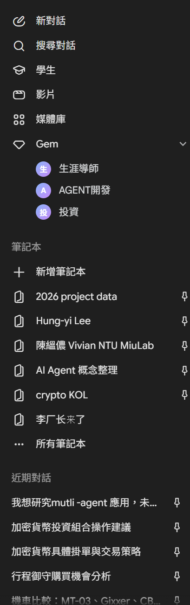

# Gemini 模型與介面選用指南 \- Google Gemini

**Date**: October 12, 2026 at 05:42 PM
**Turns**: 11
**Source**: [Gemini Chat](https://gemini.google.com/app/8324b234081fd833)

---

## Turn 1

### 👤 使用者

*[This turn includes uploaded images]*

我想了解同樣的文件資料，我提供給GEM、筆記本、一般新對話、學生、PRO、flash，得到的回覆會有哪些不同?我如何選擇?

### 🤖 助理

提供相同的文檔給不同的介面或模型，輸出的切入點、嚴謹度與格式會有顯著差異。這取決於您使用的是**工具介面**（新對話、筆記本、Gem）還是底層的**運算模型**（Pro、Flash）。
**文件解讀的差異分析**

- 筆記本 (Notebooks)：**強制模型**僅基於您上傳的資料集進行回答，極大化降低幻覺 (Hallucination)。若您將文獻放入「Hung-yi Lee」或「AI Agent 概念整理」等筆記本中，它的回覆會嚴格貼合文件內容，並能跨文獻交叉比對、附上精確的來源引註。它不會隨意擴充外部知識。
- Gem (自訂專家)：會透過您預設的系統指令 (Prompt) 戴上特定的「濾鏡」來解讀文件。例如，將同一份技術白皮書交給「投資」Gem，它會著重分析代幣經濟學與市場獲利潛力；交給「AGENT開發」Gem，它則會專注於拆解系統架構、API 規格或自動化邏輯。
- 學生 (Student)：這類帶有學習圖示的角色，通常被設定為學術導師或引導學習的模式。給予相同文件，它不會直接給出冰冷的摘要，而是會拆解艱澀術語、使用引導式提問，協助您循序漸進地消化新概念。
- 一般新對話 (New Chat)：提供通用、平衡的綜合分析。適合不受限的腦力激盪、快速探索未知領域，模型會結合文件內容與其龐大的全網訓練資料來回答。
- **Gemini Pro (運算模型)：**著重於**深度邏輯推理與複雜任務**。面對包含複雜演算法推導、多代理人 (Multi-agent) 系統架構或數論加密的長篇學術論文時，Pro 能給出最嚴密、深度的見解。
- **Gemini Flash (運算模型)：**著重於**極速反應與低延遲**。適合處理大量且結構單純的文件、快速抓取重點摘要、或是進行簡單的 Log 檔格式轉換與資料清洗。
**如何選擇最適當的工具？**

- **進行研究所文獻探討或專案知識庫建置：** 選擇 **筆記本 (Notebooks)**。將相關的論文、講義或「2026 project data」打包，確保生成的學術論述有本有源。
- **開發與撰寫複雜程式碼：** 選擇 **「AGENT開發」Gem** 或 **一般新對話** 並指定使用 **Gemini Pro**。以應付複雜的 LangGraph 狀態推導或 FastAPI 框架邏輯。
- **評估加密貨幣市場報告或交易策略：** 選擇 **「投資」Gem**。讓自訂指令自動將焦點鎖定在風險評估、資產配置與市場趨勢。
- **面對完全陌生的跨領域理論：** 選擇 **學生**。讓系統以深入淺出的教學模式，幫您從零建立基礎概念。
- **極速處理日常雜務：** 選擇 **一般新對話** 搭配 **Gemini Flash**，以最高效率完成短篇摘要、外文翻譯或信件擬稿。

## Turn 2

### 👤 使用者

*[This turn includes uploaded images]*

????

### 🤖 助理

這是一份關於「Gem」功能即將退場的系統通知。這代表我們剛才提到的 Gem 功能即將被新的機制取代。
截圖中的重點資訊如下：

- **停用日期：** Google Labs 將於 2026 年 11 月 17 日起停止提供 Gem 功能。
- **需手動轉移：** 系統不會自動為您遷移現有的工作流程。
- **未來替代方案：** 取代 Gem 的新方式是直接在 Gemini 中透過「自訂指令」建立「技能」，或者前往 Google AI Studio 建構內容。
- **資料安全：** 原有的工作流程檔案並不會被刪除，它們會繼續安全地存放在您 Google 雲端硬碟的「Opal」資料夾中。
簡而言之，您未來將不再使用獨立的「Gem」介面，而是要將像是「投資」或「AGENT開發」等客製化需求，轉化為 Gemini 內建的「技能」。如果您想現在就開始適應新機制，我可以協助您直接在此對話中建立專屬的技能。

## Turn 3

### 👤 使用者

gemini 停止ＧＥＭ服務

### 🤖 助理

Google 將於 2026 年 11 月 17 日起終止個人帳戶的「Gem」服務，並將其升級整併為 Gemini 應用程式內建的「技能 (Skills)」功能。

- **退場原因：** 原先屬於 Google Labs 實驗性質的 Gems 與自動化應用平台 Opal 已完成階段性任務，其核心自訂能力已被正式納入 Gemini 的常規產品中。
- **停用時程：** 個人 Google 帳戶於 2026 年 11 月 17 日率先停用；Workspace 企業、商業及非營利帳戶則從 2027 年 3 月起陸續轉換。
- **必須手動轉移：** 系統不會自動幫您遷移現有設定，您必須手動完成備份與重建：
  1. 開啟原本的 Gem，複製其「名稱」、「描述」與「指令」。
  2. 若 Gem 內部有上傳參考文件，需從「知識」區塊逐一下載。
  3. 進入 Gemini 側邊欄，開啟「技能 (Skills)」設定並點擊「手動建立」。
  4. 將複製的資料與檔案貼入新技能中儲存。
- **舊資料保存：** 即使服務停止，過去建立的工作流程檔案仍會安全保存在您 Google 雲端硬碟的「Opal」資料夾中供檢視與參考。
您需要我現在協助您，將您先前的「AGENT開發」或「投資」Gem 的指令內容，重新梳理成適合新版「技能」使用的最佳化架構嗎？

## Turn 4

### 👤 使用者

我在thetawave ai 的筆記當中貼入相當多來自四面八方的的文字段落加入筆記，我該如何有效的透過AI整理直接編輯的筆記中內容，將排版以及內容做的更好閱讀?

### 🤖 助理

要在 Thetawave AI 中將大量、來源零散的貼上文字轉換為易於閱讀的排版，您可以直接利用其內建的 AI 筆記生成與重組功能。請依照以下方式操作：
**1. 執行 AI 自動結構化 (AI 解析)**
不要手動排版。當您將各種來源的文字（包含網頁內容、文檔片段）貼上或匯入後，啟動 Thetawave 的 AI 解析功能。AI 會自動抓取重點，並將雜亂的文字重新改造成帶有**規範標題層級、條列式要點與表格**的結構化筆記。
**2. 設定「學習目標」來重組內容**
Thetawave 允許您設定這份筆記的用途。在讓 AI 整理時，選擇您的目標（例如：期末備考、寫作業、或是單純搞懂概念）。AI 會根據這個目標，自動調整資訊的先後順序與組織方式，讓排版更符合您當下的閱讀需求。
**3. 一鍵轉換為心智圖 (Mind Map)**
如果文字段落之間缺乏邏輯關聯，閱讀起來會很吃力。您可以使用 Thetawave 的功能，將整篇文字筆記一鍵轉換為心智圖。這能幫助您以視覺化的方式，快速看清這些零散資料之間的架構與關聯。
**4. 提取核心概念而非單純摘要**
一般的總結工具只是把文章縮短，但您可以利用 Thetawave 將資料轉化為「可複習」的狀態。指示 AI 從這些文字中專門提煉出「定義、核心論點、高頻重點」，將長篇大論精簡為清晰的知識點。
**5. 針對筆記進行深度問答**
如果您暫時不想重新排版，可以直接使用 AI 總結與問答功能。對著這份龐大的筆記提問（例如：「幫我把這幾段文字中關於某個理論的觀點比較列出來」），AI 會直接基於您貼上的上下文提供解答，幫助您快速梳理複雜概念。
您目前是將這些文字貼在同一個頁面中，還是分開存放在不同的資料夾裡？

## Turn 5

### 👤 使用者

貼入相當多來自四面八方的來自論文翻譯文字段落加入筆記，容易產生幻覺嗎?

### 🤖 助理

是的，將大量缺乏上下文、來自不同出處的「論文翻譯片段」混雜貼入筆記中，**非常容易誘發 AI 產生幻覺 (Hallucination)**。
當您將這些零散的文獻片段交給 AI 進行整理或摘要時，主要會面臨以下幾種導致幻覺的風險機制：

- **強行建立因果關係 (Forced Association)：** AI 語言模型的天性是預測與生成流暢的文本。當它面對兩段毫無關聯的論文片段時，為了讓最終生成的筆記「看起來合理且連貫」，它極可能會自行發明過渡句，甚至把 A 論文的前提錯誤套用在 B 論文的結論上，創造出原作者從未主張過的理論。
- **翻譯落差引發的「邏輯腦補」：** 學術文獻的機器翻譯往往會在複雜長句或專有名詞上出現語意模糊。當 AI 讀到這些不通順或帶有歧義的中文翻譯時，它會試圖填補邏輯漏洞。在這個「猜測原意」的過程中，很容易偏離文獻本意。
- **先決條件與脈絡遺失：** 論文的結論通常建立在嚴格的實驗環境、資料集或特定參數設定下。若只擷取翻譯段落而漏掉這些前提，AI 在重新組織時會將這些結論視為「普遍真理」，產出過度放大的錯誤知識。
- **專有名詞定義衝突：** 不同學者或不同領域對同一個術語（例如在 Edge AI 或機器學習領域中的某些特定演算法名稱）可能有微調或不同的定義。將這些段落混在一起，會讓模型在統整概念時產生混亂，生成似是而非的定義。
**如何避免 AI 在整理這些文獻筆記時產生幻覺：**

1. **設立物理邊界與來源標籤：** 在貼上不同論文的片段時，務必加上明確的區隔符號（如 `---`）與標記。例如標註 `[文獻A_邊緣運算架構]`、`[文獻B_資安加密]`。這能明確告訴 AI 這些資訊彼此獨立。
2. **施加嚴格的系統級指令 (Prompt)：** 在要求 AI 整理時，使用限制性極強的指令。例如：「請**嚴格基於以下我提供的文本**進行分類與條列摘要。**絕對禁止**引入外部知識、**禁止**自行推論段落間的因果關係。若資訊不足或矛盾，請直接保留原貌並標示出來。」
3. **保留英文關鍵字：** 在中文翻譯段落中，盡可能將核心的學術專有名詞、變數名稱或演算法保留 `(英文原文)`。這能大幅錨定 AI 的認知，避免它因中文翻譯的多義性而迷失方向。
4. **分批處理與結構化重組：** 不要一次將上萬字的混雜片段丟給 AI。先讓 AI 針對單一來源的段落進行「清理與重點條列」，確保單篇概念正確後，再進行第二階段的「跨文獻比較」。

## Turn 6

### 👤 使用者

問題是我已經貼入非常多了，現在我該如何做?

### 🤖 助理

既然已經貼入了大量零散的文字，現在的首要目標是「止損」並進行「分塊重構」，避免 AI 在處理全篇內容時將不相干的片段混為一談而產生幻覺。
請依照以下步驟清理並搶救您目前的筆記：

1. **保留原始檔案作為備份（資料庫）：** 先將這份塞滿文字的筆記複製一份，命名為「Raw_文獻翻譯備份」。這樣做可以確保在接下來的 AI 重組過程中，若有任何細節遺失或過度精簡，您隨時有原始文字可以核對。
2. **建立新的「結構化」主筆記：** 開啟一個全新的空白筆記，這將用來存放接下來清理完畢、驗證過的高品質內容。
3. **手動設定實體邊界（分治法）：** 回到原始筆記，不需要仔細閱讀，只需快速掃視。在明顯屬於不同文獻、不同章節或主題跳躍的地方，手動敲入分隔線（如 `---`）或空出三行。將萬字長文切分成每次約 500 到 1000 字的小區塊。
4. **逐塊進行「強約束」AI 整理：** 絕對不要點擊全篇總結。請反白選取「單一區塊」的文字，並使用 Thetawave 的 AI 指令輸入框，給予極度嚴格的限定指令。您可以直接複製以下 Prompt 使用：「請嚴格限制在我選取的文本範圍內，提煉出核心論點並以條列式呈現。絕對禁止引入你的外部知識，也不要自行推論前因後果。請保留英文專有名詞。若遇到翻譯極度不通順的句子，請直接引述原句並標註『(原文待釐清)』。」
5. **將乾淨的結果轉移至新筆記：** 快速檢視 AI 針對該區塊產出的重點。確認沒有無中生有的資訊後，將其複製到步驟 2 的新筆記中，並為它加上明確的標題（例如：`## 邊緣運算模型壓縮 (文獻A)`）。
重複步驟 4 與 5 逐步消化。當您將重要的區塊都轉移到新筆記後，您就能在新的筆記上安全地使用 AI 問答與心智圖功能，而不用擔心受到原始混雜文字的干擾。

## Turn 7

### 👤 使用者

*[This turn includes uploaded images]*

📎 thetawave.ai - Agentic IoT note.md

### 🤖 助理

這份名為 `thetawave.ai - Agentic IoT note.md` 的文件，是一份結構非常完整且深入的文獻整理筆記。它已經成功將原本可能零散的段落，轉化為層次分明的知識庫，這對於在邊緣運算環境中建構多代理人防護系統是非常有價值的參考。
這份筆記詳細梳理了「代理式物聯網 (Agentic IoT)」的理論與實務架構，以下是文件中的核心重點：

- **Agentic IoT 的核心定義：** 這項技術結合了自主代理的感知、推理、規劃、學習與行動能力。與傳統的 AIoT 相比，Agentic IoT 具備 LLM 驅動推理、任務分解、動態重新規劃以及多代理人協作等進階特性。
- **認知循環機制：** 代理人具備五個階段的認知循環，包含收集環境資訊的「感知」、多步邏輯分析的「推理」、制定行動步驟的「規劃」、調用 API 或致動器的「行動」，以及優化未來決策的「學習」。
- **三層次系統架構：**
  - **裝置層 (Tier 1)：** 資源受限，負責快速本地感知與即時行動。
  - **邊緣/霧層 (Tier 2)：** 扮演「產線領班」的角色，負責通訊協定橋接（例如將 ESP32 設備的輕量協定轉換為語意格式）、低延遲即時推理與短期情境記憶。
  - **雲端/智能層 (Tier 3)：** 具備強大算力，負責系統全局規劃、長期記憶儲存以及外部工具整合。
- **代理人聯網 (IoA)：** 提出 Internet of Agents 的概念，將聯網主體從硬體設備轉為具有思考能力的 AI 大腦。代理人之間透過 MCP 或 A2A 等標準協定進行溝通、協商與派工。
- **異常檢測應用：** 代理式異常檢測能夠融合多模態資料（如影像、聲音、熱感）。代理系統能自主查詢多資料來源，並利用語言模型產生人類可理解的異常診斷說明。
- **面臨的技術挑戰：** 開發過程需克服物聯網裝置的運算資源限制與即時推理造成的延遲。此外，多代理人的通訊負擔、記憶管理機制，以及如何提供涵蓋整個多步驟決策過程的可解釋性，都是當前的挑戰。
**接下來的建議運用方式：**
您目前的這份筆記已經做到了我們稍早討論的「實體邊界」與「結構化重組」。它利用了大量的表格與清晰的標題來錨定專有名詞與概念對比。
在目前的良好基礎上，您後續可以直接對著這份筆記進行高階的邏輯推演，而不用太擔心幻覺問題。例如，您可以要求 AI：「根據筆記中『邊緣/霧層』的職責與『代理式異常檢測』的特性，幫我草擬一份在邊緣伺服器上部署本地端模型的實作架構流程」。這將能有效推進您的研究或專案開發。

## Turn 8

### 👤 使用者

我該如何有效的透過AI整理直接編輯的筆記中內容，將排版以及內容做的更好閱讀?

### 🤖 助理

根據您稍早整理出來的「Agentic IoT」筆記，您其實已經示範了非常完美的排版結果（善用表格、大小標題與條列式）！
為了讓您未來在任何 AI 工具（如 Gemini、ChatGPT、Notion AI 或 Thetawave）中，都能快速把「直接編輯、隨手貼上」的零散筆記轉化為易讀的知識庫，我為您總結了一套「AI 筆記排版與優化標準工作流」**與**實用的指令 (Prompt) 模板：

### 步驟一：將 AI 的輸出格式鎖定為「Markdown」
AI 最擅長生成 Markdown 格式。在要求 AI 整理時，務必在指令中明確要求它使用以下元素，這能大幅提升閱讀體驗：

- **H2 / H3 標題 (`##`)：** 建立清晰的視覺階層。
- **條列式清單 (`-` 或 `1.`)：** 消除長篇大論的壓迫感。
- **表格 (`| |`)：** 只要文字中有「比較、分類、優缺點」，就強制 AI 畫成表格。
- **粗體 (`**`) 與 引言 (`>`)：** 用來凸顯核心關鍵字與重要定義。

### 步驟二：直接套用「場景化 Prompt 模板」
不要只跟 AI 說「幫我整理這段文字」，請直接複製以下對應場景的指令來替換您的草稿：
**場景 A：搶救極度混亂的隨手筆記（大翻修）**

> 「請幫我將以下這段混亂的筆記重新排版與優化。
> **排版要求：**
>
> 1. 請使用 Markdown 格式輸出。
> 2. 為不同主題加上適當的標題（H2, H3）。
> 3. 將冗長的段落提煉成『條列式清單』。
> 4. 若內容中存在『對比概念』或『多個項目的特徵』，請自動整理成『表格』。 **內容要求：** 修正錯字與不通順的語法，請維持我的原意，**絕對不要**自行引入外部知識或過度推論。請保留原文中的英文專業術語。」
**場景 B：為長篇筆記建立「導讀摘要」**

> 「我有一段很長的學習筆記。請幫我在這段筆記的最上方，生成一個『📖 核心導讀』區塊。
> 請包含：
>
> 1. **一句話總結：** 這段筆記的核心主旨。
> 2. **3-5 個關鍵字：** 列出最重要的概念，並附上簡短定義。
> 3. **問題意識：** 讀完這篇筆記可以解決什麼問題？」
**場景 C：處理難讀的機器翻譯或外文文獻**

> 「以下是一段生硬的文獻翻譯（或外文片段），請幫我重新潤飾並排版：
>
> 1. 將語氣轉化為流暢、符合台灣學術習慣的繁體中文。
> 2. 將重要的專業術語以『中文 (English)』的格式呈現，錨定定義。
> 3. 將長句拆解，並用條列式或粗體標示出核心論點。」

### 步驟三：分塊處理，避免 AI 迷失
如果您手寫的筆記或是貼上的資料超過 2000 字，**請不要一次全部丟給 AI**。

- **正確做法：** 將筆記切分成幾個大段落（例如：先整理「概念定義」，再整理「系統架構」），分批送給 AI 處理。這樣 AI 才能對細節進行精緻的排版，而不會為了急著總結全篇而把重要的細節省略掉。

### 步驟四：後續微調 (Human-in-the-loop)
AI 排版完後，您只需要做最後的組裝。您可以直接在整理好的筆記上方，利用 AI 再生成一個 **TOC (目錄結構)**，這樣即便是上萬字的筆記，也能一目了然。

## Turn 9

### 👤 使用者

*[This turn includes uploaded images]*

📎 thetawave.ai - Agentic IoT note.md

請幫我將這混亂的筆記重新排版與優化。排版要求：

### 🤖 助理

我現在為您將這份筆記進行全面翻修。
我會將原先擠在一起的長篇段落（例如 IoA 的比喻、三層架構的詳細解說、以及各項挑戰與未來方向的擴充說明）拆解，並嚴格遵循您的要求：保留所有英文專有名詞、不腦補外部知識、修順語句，並大量使用「條列式清單」與「表格」來呈現對比概念，打造一份層次分明、極度易讀的「學生版學霸筆記」。
我現在就開始為您生成這份優化後的筆記。
Agentic IoT 學習筆記10月12日 下午4:41已經為您完成筆記的全面改寫與排版。
**主要優化重點如下：**

1. **結構清晰化：** 替換了混亂的標題，將整份文件拆解為 8 個明確的主題區塊，並加上了視覺化 Emoji。
2. **長文表格化：** 您原本在「挑戰」、「未來發展」以及「三層架構」中的大段落文字，我都將其萃取並整合成對比表格，讓特徵與痛點一目了然。
3. **條列式梳理：** 關於 IoA 的定義與比喻，去除了生硬的文字堆疊，改用精煉的條列式與對比表呈現。
4. **去重複與潤飾：** 刪除了原文中重複出現的「多模態融合的重要性與實例」段落，並將部分不通順的機器翻譯詞彙進行了學術語境的微調（同時保留了原有的英文專有名詞）。
您可以檢視右側編輯器中的成果。這份筆記現在非常適合用來複習或是作為專案開發的參考底稿。請問您接下來想針對其中哪個區塊（例如多代理協作架構或邊緣推理）進行更深入的討論嗎？

## Turn 10

### 👤 使用者

如果將筆記視覺化成一個互動式網頁介面是否可以更完善?

### 🤖 助理

這是一個非常棒的想法！將長篇的結構化筆記轉化為**互動式網頁介面 (Interactive Dashboard)**，能大幅降低閱讀時的認知負荷 (Cognitive Load)。
相較於靜態文件，互動式網頁可以做到：

1. **資訊分層 (Progressive Disclosure)：** 預設只顯示大標題與架構圖，點擊後才展開細節（例如挑戰與未來方向），畫面不會被文字塞爆。
2. **視覺化關聯：** 將「三層次架構」和「認知循環迴圈」做成圖表或步驟按鈕，比起純文字表格更能讓人秒懂其運作邏輯。
3. **情境對比：** 利用標籤頁 (Tabs) 或卡片翻轉，讓 IoT、AIoT 與 Agentic IoT 的差異一目了然。
我現在就為您撰寫這個互動式網頁。我會採用深色科技感的主題，並加入互動元件。您可以直接在右側的預覽區點擊操作，體驗「視覺化知識庫」的效果。
Agentic IoT 互動式知識庫 <h3 class="text-xl font-bold text-white">${data.title}</h3> 
 
 ${data.desc} 
 
 <i class="fa-solid fa-circle-info mr-1"></i>此階段與 記憶、工具使用等共用模組互動。 
 `; contentBox.classList.add('fade-in'); } // Function to handle Tabs (Challenges vs Future) function switchTab(tabId) { // Get elements const btnChallenges = document.getElementById('tab-challenges'); const btnFuture = document.getElementById('tab-future'); const contentChallenges = document.getElementById('content-challenges'); const contentFuture = document.getElementById('content-future'); if (tabId === 'challenges') { // Style buttons btnChallenges.className = 'active-tab px-6 py-2 rounded-md text-sm font-medium transition-colors'; 
 <i class="fa-solid ${data.icon} ${data.color} text-xl"></i> void contentBox.offsetWidth; // trigger reflow contentBox.innerHTML = ` // Update content with animation contentBox.classList.remove('fade-in'); 'opacity-100'); }); // Highlight active node btnElement.classList.remove('opacity-70'); btnElement.classList.add('ring-2', 'ring-white/20', 'ring-offset-2', 'ring-offset-[#0f172a]', 'opacity-100'); btn.classList.add('opacity-70'); btn.classList.remove('ring-2', 'ring-white/20', 'ring-offset-2', 'ring-offset-[#0f172a]', // Reset node styles document.querySelectorAll('.loop-btn').forEach(btn => {這份 HTML 檔案完美融合了您剛剛梳理過的筆記內容。它具有以下特色：

1. **認知循環互動區 (Cognitive Loop)：** 將枯燥的表格變成了圓形的視覺互動面板。您可以隨意點擊「感知」、「推理」等節點，下方的解說面板會即時動態切換。
2. **階層視覺化 (3-Tier Architecture)：** 邊緣層與雲端層不再只是文字，而是以上下堆疊的卡片加上漸層連線呈現，讓人一眼看出「向上傳數據、向下傳指令」的實體空間感。
3. **無痛閱讀切換 (Tabs)：** 將最後一大塊的「挑戰」與「未來發展」整合進按鈕切換介面（Accordion/Tabs），畫面上不會出現壓迫性的長篇文章。
您可以點擊右側的 **Preview (預覽)** 按鈕，直接感受這種「把筆記變成 App」的閱讀體驗！如果未來您有其他複雜的論文或文件，這也是一個非常好的整理輸出格式。

## Turn 11

### 👤 使用者

如果將筆記視覺化成一個互動式網頁介面是否可以更完善?
幫助理解?有優缺點?

### 🤖 助理

將筆記視覺化為「互動式網頁介面（Interactive Dashboard）」確實能大幅提升對複雜概念的理解，但同時也伴隨著一些維護上的代價。
從認知心理學與知識管理的角度來看，將文字轉化為互動網頁有以下明確的優缺點：

### 🧠 為什麼互動介面能幫助理解？
人類的大腦在處理長篇「線性文字」（如傳統筆記）時容易感到疲勞，而互動網頁運用了「漸進式揭露 (Progressive Disclosure)」**的設計原則。也就是說，大腦一開始只需要接收「架構」與「大標題」，當讀者對某個部分感興趣並「主動點擊」時，才顯示細節資訊。這種方式能大幅降低**認知負荷 (Cognitive Load)。

### 👍 優點 (Pros)

1. **建立強大的「空間記憶」 (Spatial Memory)：**
  - *純文字：* 「邊緣層」和「雲端層」只是上下兩段字。
  - *網頁視覺化：* 讀者會清楚看到邊緣層夾在設備與雲端中間（如我們剛剛製作的 3 階層架構），這種空間關係能幫助大腦更快建立系統架構的立體模型。
2. **化被動閱讀為「主動學習」 (Active Learning)：**
  - 當您需要「點擊」按鈕才能看到「感知、推理、規劃」的內容時，這個微小的肢體動作會強迫大腦集中注意力，將被動接收轉化為主動探索，記憶力會比單純滑動滾輪更好。
3. **資訊降噪，隨選閱讀：**
  - 利用頁籤 (Tabs) 或折疊面板 (Accordion) 隱藏次要資訊（例如未來挑戰與研究方向）。畫面看起來乾淨清爽，不會給人「這篇好長、好難懂」的心理壓力。
4. **極佳的簡報與展示效果：**
  - 如果您需要向教授、主管或客戶解釋 Agentic IoT 的概念，直接開啓這個互動網頁，比起丟給他們一份 Word 或 PDF 檔，專業度與說服力會呈指數級上升。

### 👎 缺點與限制 (Cons)

1. **後續編輯與維護成本極高：**
  - *痛點：* 在 Markdown 或 Notion 筆記中，新增一段話只需直接打字。但在互動網頁中，若要新增一個章節，您必須尋找對應的 HTML 標籤 (`
`, `<li>`) 或修改 JavaScript 陣列。對於不懂程式碼的人來說，幾乎無法輕易擴充內容。
2. **失去「知識庫」的便攜性與搜尋性：**
  - 傳統文字筆記（Markdown）可以輕易匯入 Obsidian、Notion、Logseq 等知識管理軟體，並且支援全局關鍵字搜尋。而封裝成 HTML 的網頁，很難與您其他的筆記產生雙向連結（Backlinks）或進行統一檢索。
3. **過度設計 (Over-engineering) 的風險：**
  - 有時候花費大量時間調整網頁的動畫、漸層與按鈕樣式，反而會讓人分心，忽略了「吸收知識」這個核心目的。

### 💡 結論與建議：我該如何選擇？
最好的策略是「雙軌並行」，將它們用在不同的生命週期：

1. **平時累積與研究階段 ➡️ 使用純文字/Markdown (如稍早整理的筆記)**
  - 作為您的「單一真相來源 (Single Source of Truth)」。隨時複製貼上、隨時修改，確保知識能被搜尋與關聯。
2. **概念整合、報告或對外展示階段 ➡️ 透過 AI 轉換為「互動網頁」**
  - 當一個主題（例如 Agentic IoT）的研究已經告一段落，架構已經定型，且您需要經常複習它的「大圖像 (Big Picture)」，或者需要向他人講解時，再請 AI 將其打包成互動式網頁。
現在有了 AI 的輔助，您已經不需要手動去刻劃網頁。您可以永遠只維護您的 Markdown 筆記，當需要視覺化時，只要把筆記丟給 Gemini 說：**「請根據這份筆記，幫我生成一個互動式知識網頁」**，就能瞬間享受兩者的優點了！

---

*Exported from [Voyager](https://github.com/Nagi-ovo/voyager)*  
*Generated on October 12, 2026 at 05:42 PM*